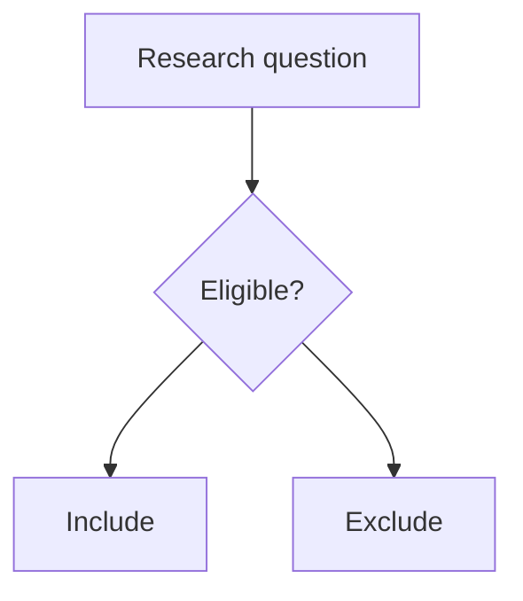

# Charts and flowcharts in Ask AI

Ask the assistant to plot numbers from the PDF or draw a flowchart of a process. The shared system prompt describes the supported formats to ChatGPT, Claude, OpenRouter and custom endpoints. Actual output quality still depends on the selected model. Missing numbers should be called out rather than invented.

Charts render after the answer finishes. Stored responses render again when reopened. Copy response preserves the original fenced Markdown; View source shows the diagram definition. Malformed or unsupported definitions stay readable with an explanation instead of breaking the conversation.

## Charts

Use a fenced `chart` block containing JSON:

````markdown
```chart
{"type":"bar","title":"Example data","xLabel":"Month","yLabel":"Value","labels":["Jan","Feb"],"series":[{"name":"A","values":[10,20]},{"name":"B","values":[15,25]}]}
```
````

- Types: `line`, `bar`, `scatter`, `pie`.
- Line and bar: labels and each series must have the same length. `null` represents a missing value.
- Scatter: omit labels and supply number pairs, e.g. `values:[[1,3],[2,5]]`.
- Pie: one series with non-negative numbers and unique labels.
- Optional: title, xLabel, yLabel, series name. Limits: 12 series, 500 values per series, 200 characters per label, 100,000 characters per block.
- Hover to inspect values; click legend buttons to hide/show series or pie slices.
- Cartesian charts include a horizontal range slider, zoom buttons, reset and Ctrl+wheel zoom. Pie charts have hover and legend controls, without range zoom.
- Resizing the chat panel resizes the chart. Chart colors adapt to the app theme.

This is a data-only format, not arbitrary ECharts configuration. Extra fields are not forwarded to ECharts. It cannot run model-written JavaScript, load remote images, or call tools. ECharts is bundled locally and uses canvas tooltips.

## Flowcharts

Use a fenced `mermaid` block:

````markdown

````

This version supports plain `flowchart`/`graph` diagrams, including nodes, decisions, edges and subgraphs. It does not support other Mermaid diagram families, initialization directives, HTML labels, click links, image nodes, or custom styles. Limits: 12,000 source characters and 100 edges.

The default view fits both width and height. Use +/− to zoom, Fit to reset, and scroll inside the diagram to pan. Mermaid renders with strict security and HTML labels disabled. The resulting SVG is displayed as an image, not injected into the chat DOM. All dependencies are bundled locally.

## Verification

`npm test` covers the data validation. `npm run test:chat-math` covers existing Markdown, tables and mathematics. After `npm run build`, `npm run test:ai-layout` uses an isolated hidden Electron session and mock streamed responses to check charts, legends, hover, zoom, flowcharts, invalid input, table layout, panel resizing, reopening and icon styling. The same visualization checks are included in `npm run smoke`.
